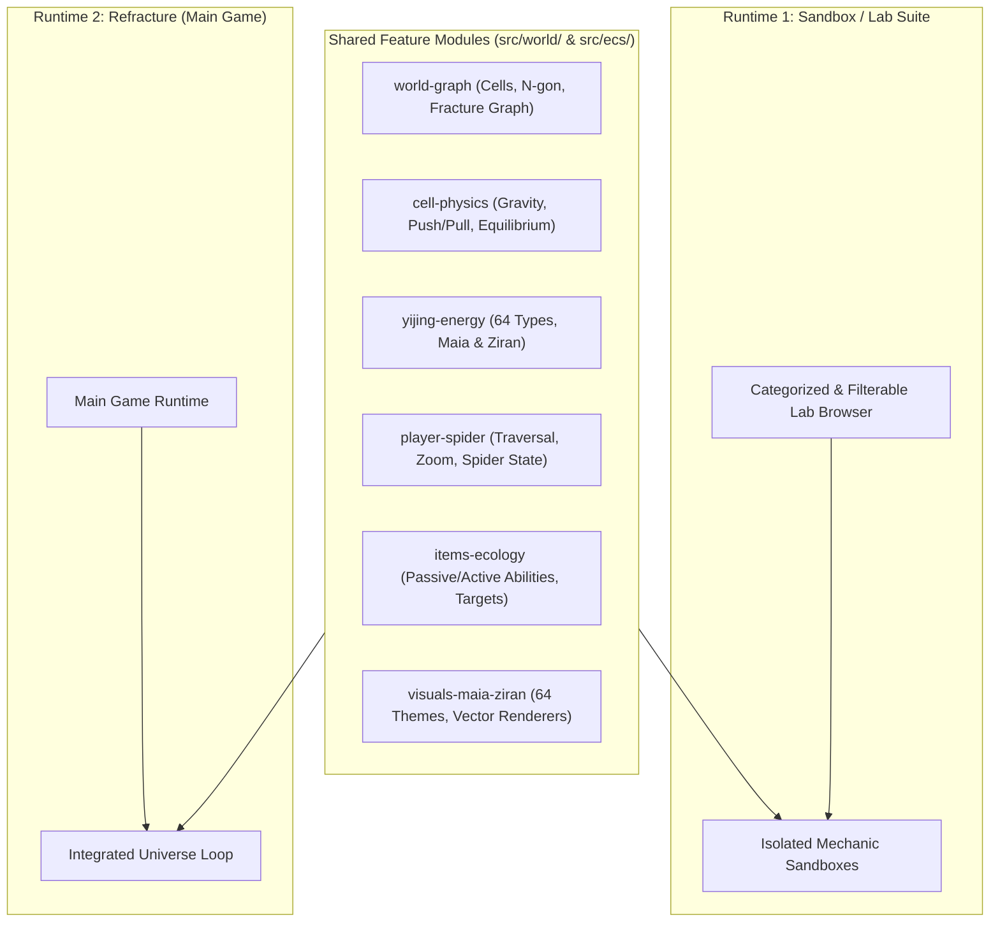

# Refracture

> **A game about a spider. And neurodivergence.**

[](LICENSE)

**Refracture** is an atmospheric 2D physics-platformer and procedural world-simulation game centered on a jumping spider navigating a shattered cosmos. Reality has fractured into floating polygon shards ("cells") suspended in a limitless coordinate space; the player traverses across shards using precision 360° slingshot jumps, surface adhesion, silk tether stitching, and emergent 64-type Yijing energy interactions.

The project is built for **indie physics-platformer players** and **procedural-generation / game-architecture enthusiasts**, featuring a **Dual-Runtime Architecture**:
1. **Game Runtime (`Refracture`)**: The main playable experience where validated mechanics come together in an integrated fractured universe.
2. **Lab Suite (`Lab Runtime`)**: A categorized interactive sandbox gallery organized across 6 design spaces (plus 24 experimental prototypes) for isolating, tuning, and stress-testing physics, shaders, procedural graphs, and AI behaviors.

---

## Built With

- **Engine & Rendering**: [Phaser 3](https://phaser.io/) (`^3.80.1`) with custom WebGL post-processing fragment shader pipelines (`AquarellePipeline`, `GrayscalePipeline`, `OldGlassPipeline`, `RainbowPipeline`) and procedural vector geometry renderers.
- **Architecture**: Custom lightweight Entity Component System (`src/ecs/`) with pure data components and deterministic fixed-step physics systems (`60 Hz` accumulator).
- **Procedural Geometry**: Custom topological N-gon + 2D Perlin-noise fracture graph generator (`src/world/FractureGraph.js`) and spatial query engine (`src/world/GraphQueries.js`).
- **Desktop Wrapper & Native Gamepad Bridge**: [Electron](https://www.electronjs.org/) (`^40.0.0`) paired with a self-compiling macOS Objective-C helper (`src/native/mac_gamepad.m`) bridging Apple's `GameController.framework` directly into Chromium's Gamepad API.
- **Bundler & Build Orchestrator**: [Vite](https://vitejs.dev/) (`^5.0.0`) and a multi-target build script (`scripts/build.cjs`) supporting clean standalone builds (`game`, `web`, `steam`, `mac`, `windows`, `linux`, `xbox`, `lab`).

---

## How to Run

### Prerequisites
- **Node.js** `>= 18.x` and **npm**
- *(Optional, for desktop mode on macOS)* Xcode Command Line Tools (`clang`) for automatic compilation of the native `GameController` bridge.

### 1. Install Dependencies
```bash
npm install
```

### 2. Run in Browser (Vite Dev Server)
Use the included `./runserver` launcher (or npm scripts) to start either runtime:

```bash
# Launch the Main Game Runtime at http://localhost:3000
./runserver
# or: npm run dev:game

# Launch the Lab / Sandbox Suite at http://localhost:3001
./runserver lab
# or: npm run dev:lab
```

### 3. Run as Desktop App (Electron)
In a second terminal (while the Vite server is running on port `3000` or `3001`), launch the Electron shell:

```bash
# Desktop wrapper for Main Game Runtime (connects to port 3000)
npm run start:game

# Desktop wrapper for Lab Suite (connects to port 3001)
npm run start:lab
```

### 4. Production Builds
Build standalone bundles into `dist/<target>/` with an accompanying `build-manifest.json`:

```bash
npm run build          # Builds standalone Game Runtime to dist/game/
npm run build web      # Builds Web Game Bundle to dist/web/
npm run build lab      # Builds Developer Lab & Sandbox Suite to dist/lab/
```

### Controls
| Action | Keyboard | Gamepad (Xbox / DualSense) |
| :--- | :--- | :--- |
| **Move / Walk on Cell Surface** | `A` / `D` or `Left` / `Right` | Left Stick |
| **Aim Slingshot Jump (360°)** | `I` `J` `K` `L` | Right Stick (hold & release) |
| **Menu Navigation / Select** | `W` `A` `S` `D` / `Enter` or `Space` | D-Pad or Left Stick / `A` (`Cross`) |
| **Inspect / Toggle Graph Overlay (Lab)** | `G` / `U` / `R` (reseed) | Shoulder Buttons |
| **Back to Menu** | `Escape` | `B` (`Circle`) or `Back` / `Select` |

---

## Roadmap & Planned Work Ahead (45+ Hours)

Active development is organized around promoting prototypes from the **Lab Suite** into the **Main Game Runtime** across our 6 Design Spaces. See [`docs/GAME_DESIGN.md`](docs/GAME_DESIGN.md) for full mechanical specifications.

- [ ] **Phase 1 — Space 1 (`world-graph`): True Perlin Branching & Edge-Split Polygon Extraction (~8 hrs)**
  - [ ] Upgrade `FractureGraph.js` from perturbed Voronoi/lloyd relaxation to iterative Perlin-noise ray propagation with configurable branching angles (`branchingFactor`) and exact line-segment intersection splitting.
  - [ ] Add interactive graph inspector tools in `01_WorldGraphLab.js` (corner/edge ID inspection, neighbor highlighting, and animated scramble/unscramble transitions).
  - [ ] Add unit test suite verifying planar graph invariants (Euler characteristic, zero overlapping cells, area bounds `100` player units to `1%` of universe).
- [ ] **Phase 2 — Space 2 (`cell-physics`): Mutual N-Body Cell Gravity, Silk Stitching & Equilibrium (~10 hrs)**
  - [ ] Implement `CellGravitySystem` computing mass-proportional gravitational attraction (`mass = area * density`) between scrambled land cells in 64-bit coordinate space.
  - [ ] Implement `StitchTether` component and `StitchPhysicsSystem` (Hooke's law spring-damper tethers connecting two shards, player tension tuning, and Newtonian launch kickback).
  - [ ] Implement player & item land-manipulation forces (pushing/pulling shards toward equilibrium).
- [ ] **Phase 3 — Space 3 (`yijing-energy`): 64-Type Energy Profiles, Maia & Ziran State Engine (~8 hrs)**
  - [ ] Build `EnergyProfile` component (`Float32Array(64)`) for cells, entities, and cosmic background.
  - [ ] Implement `MaiaSystem` (global universe hexagram state) and `ZiranSystem` (local cell/entity state) with emergent energy transmission along silk stitches and contact points.
  - [ ] Create `03_YijingEnergyLab.js` sandbox with real-time 64-channel spectrum visualizer and hexagram state switcher.
- [ ] **Phase 4 — Space 4 (`player-spider`): Dot-to-Spider Vector Zoom & State-Driven Morphology (~6 hrs)**
  - [ ] Implement smooth logarithmic camera zoom transitioning seamlessly from macro universe view (player rendered as a 1-unit dot) to micro inspection view (procedural articulated spider rig).
  - [ ] Wire player state & local Ziran to procedural spider leg kinematics, eye glow, and trail rendering.
- [ ] **Phase 5 — Space 5 (`items-ecology`): Unified Ecological Item System (~7 hrs)**
  - [ ] Implement unified `Item` entity architecture differentiated by Ziran into creatures, plants, and objects.
  - [ ] Implement passive (`consumable`, `carryable`) and active (`walks`, `eats`, `carries`, `moves_land`) ability resolvers with 64-type target masks (e.g. `eats: [64, 63, 62]`).
  - [ ] Build `05_EcologyLab.js` sandbox demonstrating self-sustaining creature/plant generation and consumption loops.
- [ ] **Phase 6 — Space 6 (`visuals-maia-ziran`) & World Progression (~8 hrs)**
  - [ ] Author procedural visual themes mapping the 64 I Ching states to background shader uniforms (`Maia`) and cell/entity styles (`Ziran`).
  - [ ] Build the Cosmic Constellation world map & node gating controller (connecting major shards with woven silk threads as zones are completed).

---

## 1. Grouped Design Spaces

To develop **Refracture** iteratively without deep rewrites, the design is divided into **6 distinct spaces**. Each space can be prototyped in isolation in the **Lab Runtime** and promoted into the **Game Runtime**.

### Space 1: World Geometry, Seeding & Fracture Graph (`world-graph`)
* **Land (Cells) & Sky (Space)**:
  * The world consists of **platforms (land)** called **cells**, and **space (sky)**—anything that is not a piece of land.
  * The universe exists in a limitless **64-bit $(x, y)$ coordinate space**.
* **Scale & Units**:
  * **1 unit circle = 1 player area** (the size of the player).
  * The complete circular land mass is **1 universe wide** (always **$\ge 1,000$ player diameters** across; exact $1/n$ ratio tuned for fun).
  * Seeding a universe fractures the circle into cells ranging from **100 player areas** up to **1/100th of the universe size**.
* **Fractured Whole, Cell Graph Metadata & Scrambled Land**:
  * Cells are shards of a fractured whole—like a **pane of broken glass**—represented as a pure topological hierarchy with no redundant neighbor arrays:
    * **Corner**: Tracked by a unique `id` and its $(x, y)$ coordinates.
    * **Edge**: Tracked by a unique `id` and two corner IDs (`[cornerA, cornerB]`). Neighboring edges are implicitly known because they share a corner ID.
    * **Cell**: Defined purely as the unique collection of `edgeIds` that enclose it. Neighboring cells (in the unscrambled circle) are implicitly known because they share an edge ID—no separate neighbor metadata is stored.
  * When all graph edges are placed in their unscrambled positions, the cells form a complete circle 1 universe wide, **but in gameplay the land will be scrambled in space**.
* **Procedural Fracture Algorithm**:
  * **Universe Boundary**: Approximated as a regular **N-gon** whose corner/edge count fits an **even bit / power-of-two** (e.g., **128** boundary corners and edges).
  * **Perlin Branching**: Starting from a randomly seeded **fracture point** inside the N-gon, fracture lines propagate outward toward the boundary edges using **Perlin noise**, branching at random angles controlled by a branching variable.
  * **Cell Formation**: Closed cells are formed wherever fracture branches **intersect** one another or **reach the N-gon boundary edges**.

---

### Space 2: Physics, Cell Gravity & Equilibrium (`cell-physics`)
* **Mutual Cell Gravity**:
  * Land cells exert **gravitational pull** on one another based on their **mass**.
  * Initially, **mass = cell area (size)**; later, different cell types will have distinct **densities** based on emergent gameplay properties.
* **Land Manipulation**:
  * Cells can be **pushed, pulled, and manipulated** both by the **player** and by **items** that have land-moving abilities.
* **Yijing-Modified Equilibrium**:
  * By default, cells seek a physical **equilibrium** governed by physics and modified by the current **Yijing state**.

---

### Space 3: 64-Type Yijing Energy System (`yijing-energy`)
* **The 64 Energy Types**:
  * There are **64 unnamed energy types** (`0..63` / `1..64`), each corresponding to a theme from the **I Ching (Yijing)**.
* **Stored vs. Background Energy**:
  * **Cell Stored Energy**: Each land cell stores energy across the 64 types.
  * **Background Energy**: The background/universe also carries a 64-type energy profile calculated by a dedicated system.
* **Maia & Ziran**:
  * **Maia**: The **universal state** of the Yijing.
  * **Ziran**: The **local state** of the Yijing (per cell / item / region).
* **Universal Entity Interaction & Transmission**:
  * Every entity (**item, land cell, player**) interacts with the 64 energy types.
  * Abilities can **transmit Yijing energy** in various ways, with exact transmission rules discovered emergently for fun gameplay.

---

### Space 4: Player (The Spider), Scale & Camera Zoom (`player-spider`)
* **Dot-to-Spider Zoom**:
  * At normal gameplay scale, the player is rendered as a **small dot**.
  * Pressing a **zoom button** zooms the camera in on the player, revealing the **image of a spider**.
  * **Vector Scalable**: Coordinate units translate dynamically to screen pixels based on current zoom and universe size.
* **State Chain**:
  * **Universe State (Maia / Local Ziran)** $\rightarrow$ manipulates **Player State** $\rightarrow$ changes the **visual appearance of the spider**.
* **Base Capabilities**:
  * Walk around on land cells.
  * Jump from cell to cell.
  * Touch items (triggering state changes).
  * Push/pull and manipulate land cells.

---

### Space 5: Ecological Item System (`items-ecology`)
* **Unified Item Model Differentiated by Ziran**:
  * **Items (creatures)**, **items (plants)**, and **items (objects)** share a unified item architecture whose role, behavior, and visual style depend on their **Ziran** (local Yijing state).
* **Passive & Active Abilities with 64-Type Targets**:
  * **Passive abilities**: e.g., *consumable*, *carryable*.
  * **Active abilities**: e.g., *walks*, *eats*, *carries*, *moves land*.
  * **Target Ranges**: Each ability targets a specific subset of the 64 energy types (e.g., `eats: [64, 63, 62]`, `carries: [d, e, f]`).
* **Ecological Loop**:
  * Items (acting as creatures/plants) can **generate** and **consume** other items based on their abilities and energy interactions.

---

### Space 6: Visual Language & Procedural Art (`visuals-maia-ziran`)
* **Maia (Universal State Visuals)**:
  * Each of the 64 I Ching states defines a theme that drives procedural **colors, actions, and visual styles for the background**.
* **Ziran (Local State Visuals)**:
  * Drives the procedural visual style and form of **creatures, plants, and objects**, as well as local cell appearance.

---

## 2. Dual-Runtime & Modular Architecture

To avoid a cluttered test list and prevent deep rewrites as mechanics evolve, the project is structured around **two runtimes** sharing **pure, self-contained feature modules**:



1. **Runtime 1 — Sandbox / Lab Suite (`Lab Runtime`)**:
   * A filterable, categorized gallery organized by the **6 Design Spaces** (plus an archive/filter for legacy experiments).
   * Used to build, tweak, and stress-test individual mechanics in tiny, fast-loading sandboxes.
2. **Runtime 2 — Refracture (`Game Runtime`)**:
   * The actual game runtime where validated modules from the Lab are composed into the full fractured-universe experience.
3. **Zero-Rewrite Module Contract**:
   * Mechanics are never hardcoded inside a specific test scene. Instead, each mechanic lives in a modular unit (Component/State + System/Logic + Renderer) and scenes only **configure and compose** those modules. Promoting a mechanic from the Lab to the Main Game is simply importing and enabling that module in the Game runtime.

---

## License

Released under the [MIT License](LICENSE).
