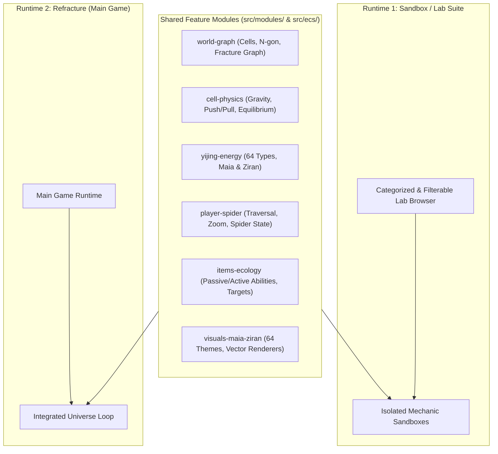

# Refracture

> **A game about a spider. And neurodivergence.**

---

## 1. Grouped Design Spaces

To develop **Refracture** iteratively without deep rewrites, the design is divided into **6 distinct spaces**. Each space can be prototyped in isolation in the **Lab Runtime** and promoted into the **Game Runtime**.

### Space 1: World Geometry, Seeding & Fracture Graph (`world-graph`)
* **Land (Cells) & Sky (Space)**:
  * The world consists of **platforms (land)** called **cells**, and **space (sky)**—anything that is not a piece of land.
  * The universe exists in a limitless **64-bit $(x, y)$ coordinate space**.
* **Scale & Units**:
  * **1 unit circle = 1 player area** (the size of the player).
  * The complete circular land mass is **1 universe wide** (always **$\ge 1,000$ player diameters** across; exact $1/n$ ratio tuned for fun).
  * Seeding a universe fractures the circle into cells ranging from **100 player areas** up to **1/100th of the universe size**.
* **Fractured Whole, Cell Graph Metadata & Scrambled Land**:
  * Cells are shards of a fractured whole—like a **pane of broken glass**—represented as a pure topological hierarchy with no redundant neighbor arrays:
    * **Corner**: Tracked by a unique `id` and its $(x, y)$ coordinates.
    * **Edge**: Tracked by a unique `id` and two corner IDs (`[cornerA, cornerB]`). Neighboring edges are implicitly known because they share a corner ID.
    * **Cell**: Defined purely as the unique collection of `edgeIds` that enclose it. Neighboring cells (in the unscrambled circle) are implicitly known because they share an edge ID—no separate neighbor metadata is stored.
  * When all graph edges are placed in their unscrambled positions, the cells form a complete circle 1 universe wide, **but in gameplay the land will be scrambled in space**.
* **Procedural Fracture Algorithm**:
  * **Universe Boundary**: Approximated as a regular **N-gon** whose corner/edge count fits an **even bit / power-of-two** (e.g., **128** boundary corners and edges).
  * **Perlin Branching**: Starting from a randomly seeded **fracture point** inside the N-gon, fracture lines propagate outward toward the boundary edges using **Perlin noise**, branching at random angles controlled by a branching variable.
  * **Cell Formation**: Closed cells are formed wherever fracture branches **intersect** one another or **reach the N-gon boundary edges**.

---

### Space 2: Physics, Cell Gravity & Equilibrium (`cell-physics`)
* **Mutual Cell Gravity**:
  * Land cells exert **gravitational pull** on one another based on their **mass**.
  * Initially, **mass = cell area (size)**; later, different cell types will have distinct **densities** based on emergent gameplay properties.
* **Land Manipulation**:
  * Cells can be **pushed, pulled, and manipulated** both by the **player** and by **items** that have land-moving abilities.
* **Yijing-Modified Equilibrium**:
  * By default, cells seek a physical **equilibrium** governed by physics and modified by the current **Yijing state**.

---

### Space 3: 64-Type Yijing Energy System (`yijing-energy`)
* **The 64 Energy Types**:
  * There are **64 unnamed energy types** (`0..63` / `1..64`), each corresponding to a theme from the **I Ching (Yijing)**.
* **Stored vs. Background Energy**:
  * **Cell Stored Energy**: Each land cell stores energy across the 64 types.
  * **Background Energy**: The background/universe also carries a 64-type energy profile calculated by a dedicated system.
* **Maia & Ziran**:
  * **Maia**: The **universal state** of the Yijing.
  * **Ziran**: The **local state** of the Yijing (per cell / item / region).
* **Universal Entity Interaction & Transmission**:
  * Every entity (**item, land cell, player**) interacts with the 64 energy types.
  * Abilities can **transmit Yijing energy** in various ways, with exact transmission rules discovered emergently for fun gameplay.

---

### Space 4: Player (The Spider), Scale & Camera Zoom (`player-spider`)
* **Dot-to-Spider Zoom**:
  * At normal gameplay scale, the player is rendered as a **small dot**.
  * Pressing a **zoom button** zooms the camera in on the player, revealing the **image of a spider**.
  * **Vector Scalable**: Coordinate units translate dynamically to screen pixels based on current zoom and universe size.
* **State Chain**:
  * **Universe State (Maia / Local Ziran)** $\rightarrow$ manipulates **Player State** $\rightarrow$ changes the **visual appearance of the spider**.
* **Base Capabilities**:
  * Walk around on land cells.
  * Jump from cell to cell.
  * Touch items (triggering state changes).
  * Push/pull and manipulate land cells.

---

### Space 5: Ecological Item System (`items-ecology`)
* **Unified Item Model Differentiated by Ziran**:
  * **Items (creatures)**, **items (plants)**, and **items (objects)** share a unified item architecture whose role, behavior, and visual style depend on their **Ziran** (local Yijing state).
* **Passive & Active Abilities with 64-Type Targets**:
  * **Passive abilities**: e.g., *consumable*, *carryable*.
  * **Active abilities**: e.g., *walks*, *eats*, *carries*, *moves land*.
  * **Target Ranges**: Each ability targets a specific subset of the 64 energy types (e.g., `eats: [64, 63, 62]`, `carries: [d, e, f]`).
* **Ecological Loop**:
  * Items (acting as creatures/plants) can **generate** and **consume** other items based on their abilities and energy interactions.

---

### Space 6: Visual Language & Procedural Art (`visuals-maia-ziran`)
* **Maia (Universal State Visuals)**:
  * Each of the 64 I Ching states defines a theme that drives procedural **colors, actions, and visual styles for the background**.
* **Ziran (Local State Visuals)**:
  * Drives the procedural visual style and form of **creatures, plants, and objects**, as well as local cell appearance.

---

## 2. Dual-Runtime & Modular Architecture

To avoid a cluttered test list and prevent deep rewrites as mechanics evolve, the project is structured around **two runtimes** sharing **pure, self-contained feature modules**:

1. **Runtime 1 — Sandbox / Lab Suite (`Lab Runtime`)**:
   * A filterable, categorized gallery organized by the **6 Design Spaces** (plus an archive/filter for legacy experiments).
   * Used to build, tweak, and stress-test individual mechanics in tiny, fast-loading sandboxes.
2. **Runtime 2 — Refracture (`Game Runtime`)**:
   * The actual game runtime where validated modules from the Lab are composed into the full fractured-universe experience.
3. **Zero-Rewrite Module Contract**:
   * Mechanics are never hardcoded inside a specific test scene. Instead, each mechanic lives in a modular unit (Component/State + System/Logic + Renderer) and scenes only **configure and compose** those modules. Promoting a mechanic from the Lab to the Main Game is simply importing and enabling that module in the Game runtime.

---

## 3. Raw Idea Capture Log

- Core identity: **Refracture** — a game about a spider, and about neurodivergence.
- World composition: Two primary spatial elements — **platforms (land)** and **space (sky)**.
- Player representation & zoom:
  - At normal view, the player is shown as a **small dot**.
  - Pressing a **zoom button** zooms in on the player, revealing the **image of a spider**.
- State relationship:
  - The **spider's visual appearance changes** based on **player state**.
  - **Player state** is manipulated by **universe state**.
- Land / World structure & Graph metadata:
  - The land is made of **chunks (cells)**, represented in metadata as a **graph**:
    - Each **corner** is tracked as a unique `id` with $(x, y)$ coordinates.
    - Each **edge** is defined by two corner IDs; neighboring edges are identified naturally because they share a corner ID.
    - Each **cell** is a unique collection of edge IDs (`edgeIds`); the edges make the cells, and shared edge IDs implicitly define original neighbors without storing extra neighbor metadata.
  - Each chunk is a shard of a **fractured whole**, like a **pane of broken glass**.
  - When all edges of the graph are placed in their correct positions, the chunks form a complete **circle 1 universe wide**, **but the land will be scrambled**.
  - Scale: The player is **1/nth of the universe** (exact scale to be tuned for fun during development).
- Seeding, Fractures & Coordinate Units:
  - Unit definition: **1 player area = 1 unit circle** (the size of the player).
  - Universe minimum size: Always **1,000 player diameters across or more**.
  - Fracture / chunk sizes: Seeding a universe generates fractures ranging from **100 player areas** up to **1/100th of the universe size**.
  - **Vector scalable**: Units-to-pixels translation is dynamic based on current **zoom** and **universe size**.
- Cells, Geometry & Fracture Generation Algorithm:
  - **Cells**: Each piece of land is called a **cell**.
  - **Cell topology**: Each cell has $x$ **edges**, and each edge has two **corners** (each corner defined by two coordinates $(x, y)$).
  - **Universe boundary (N-gon)**:
    - The circular universe is approximated as a regular **N-gon** so boundary corners and edges already exist to close outer cells.
    - The number of boundary corners/edges should fit cleanly into an **even bit / power-of-two** count (e.g., **128** corners/edges).
  - **Procedural fracture generation**:
    - Start with the N-gon circle and a randomly chosen **fracture point**.
    - Propagate **fracture lines** outward toward the universe boundary using **Perlin noise**.
    - **Branch** off at random angles controlled by a branching variable.
    - **Cells** are formed wherever fracture branches **intersect** one another or **reach the boundary edges**.
- Sky, Coordinate Space & Cell Gravity:
  - **Sky**: Anything that is not a piece of land (cell).
  - **Limitless space**: The universe exists in a **64-bit address space** for $(x, y)$ coordinates.
  - **Gravitational pull between cells**:
    - Land units (cells) exert **gravitational pull** on one another based on their **mass**.
    - Initially, **mass = cell size (area)**, with per-cell **density** introduced later based on emergent design properties discovered during development.
- Player Base Abilities & Item System:
  - **Starting player abilities**:
    - Walk around on platforms (cells).
    - Jump from platform to platform.
    - Touch **items** (touching an item impacts *some* state).
  - **Items & Abilities**:
    - Items possess **passive abilities** (e.g., *consumable*, *carryable*) and **active abilities** (e.g., *walks*, *eats*, *carries*).
    - Each ability defines a **range/set of valid targets** (e.g., `eats: [x, y, z]`, `carries: [d, e, f]`, where `x, y, z` correspond to energy types like `64, 63, 62`).
    - **Creatures vs. Items (Ecological Loop)**: Items (acting as *creatures*) can **generate** and **consume** other items based on their abilities.
    - **Ziran-Driven Item Differentiation & Energy Transmission**:
      - What differentiates an item (e.g., creature, plant, object, and its behavior/role) depends on its **Ziran** (local Yijing state).
      - Item abilities can **transmit Yijing energy** in various ways, with exact transmission mechanics discovered and tuned emergently for fun gameplay.
- 64-Type Energy System:
  - **64 unnamed energy types** (`1..64` or `0..63`).
  - **Cell stored energy**: Each land segment (cell) holds stored energy across the 64 types.
  - **Background energy**: The universe/background also has energy measured across the same 64 types (calculated via a system we will develop iteratively).
  - **Universal entity interaction**: Every entity (**item**, **land/cell**, **player**) has distinct interactions with the 64 energy types (and ability targets like `x, y, z` map directly to energy type indices such as `64, 63, 62`).
- Land Manipulation, Equilibrium & Yijing State:
  - **Pushing / Pulling / Manipulating Land**: Land cells can be pushed, pulled, and manipulated both by the **player** and by **items** that have land-moving abilities.
  - **Equilibrium & Yijing (I Ching) State**: By default, land cells seek **equilibrium** governed by **physics**, modified by the current **Yijing state** (connecting with the 64-type structure).
  - **Visual Language of Yijing States**:
    - **64 I Ching Themes**: Each of the 64 energy/Yijing states has a distinct theme based on the I Ching.
    - **Maia (Universal Yijing State)**: Visual elements that hint toward the universal state of the Yijing — driving generated **colors, actions, and visual styles for the background**.
    - **Ziran (Local Yijing State)**: Visual elements that hint toward the local state of the Yijing — driving the visual style of **items (creatures)**, **items (plants)**, and **items (objects)**.
