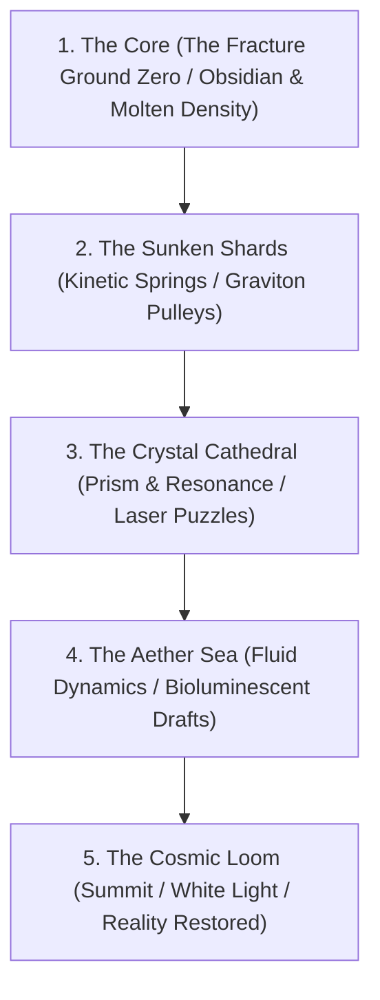

# REFRACTURE — Game Design Document
*Stitching the Fractured Cosmos*

---

## 1. Executive Summary & Core Pitch

**Refracture** is an atmospheric physics-platformer and puzzle-action game centered on an agile jumping spider ascending through a shattered universe. 

During **The Fracture**, reality broke apart into isolated elemental shards, casting the Spider down into the deepest zero-point: **The Core of the Universe**. To restore reality, the Spider must climb through the vertical void, physically and harmonically **stitching the cosmos back together** with silk tethers and elemental physics.

### Core Gameplay Loops
1. **Traverse & Slingshot:** Sling through vast vertical environments with high-precision physics-driven spider mobility.
2. **Interact & Attune:** Stand on, connect, and launch from diverse elemental platforms, altering the Spider's physical state, jump power, weight, and combat abilities.
3. **Stitch & Synthesize:** Anchor and link elemental shards with web tethers ("stitches") to complete circuits, generate tension trampolines, counterbalance gravitational anchors, and trigger elemental reactions.

---

## 2. The Triad of Interaction (Player Verbs)

Every interactive shard in the Fracture belongs to an **Elemental Affinity**. The physical effect is determined by *how* the Spider interacts with that shard:

```
                  ┌───────────────────────────────┐
                  │          THE SPIDER           │
                  └───────────────┬───────────────┘
                                  │
         ┌────────────────────────┼────────────────────────┐
         ▼                        ▼                        ▼
 ┌───────────────┐        ┌───────────────┐        ┌───────────────┐
 │   STANDING    │        │   STITCHING   │        │ SLINGSHOTTING │
 │  (Perching)   │        │  (Connecting) │        │ (Transition)  │
 ├───────────────┤        ├───────────────┤        ├───────────────┤
 │ • Attunement  │        │ • Tension     │        │ • Momentum    │
 │ • Absorption  │        │ • Conduction  │        │ • Dispersion  │
 │ • Static Load │        │ • Synthesis   │        │ • Ranged Shot │
 └───────────────┘        └───────────────┘        └───────────────┘
```

### 1. Standing (Perching & Attunement)
- **Mechanic:** The Spider lands and clings to a shard.
- **Physical Consequence:**
  - Absorbs the shard’s elemental aura over 0.5–1.5 seconds.
  - Temporarily changes the Spider’s mass, friction, or gravity scale.
  - May trigger passive charging: warming up, cooling down, or harmonizing.
- **Trade-off:** Staying perched stabilizes unstable elements, but can drain platform integrity or risk overheating/freezing.

### 2. Stitching (Connecting & Transmission)
- **Mechanic:** The Spider shoots a silk anchor to Shard A, climbs or leaps, and anchors to Shard B, creating a taut **Stitch Tether**.
- **Physical Consequence:**
  - **Tension Bridges:** Creates bouncy trampolines that amplify slingshot velocity based on cord tension.
  - **Energy Conduction:** Transmits elemental power between distant shards (e.g. powering a dormant gate or bridging light beams).
  - **Coupling & Counterbalances:** Pairs a buoyant shard with a heavy anchor to pull floating platforms into alignment.
  - **Elemental Reactions:** Linking two differing elements initiates a reaction along the thread (e.g., Fire + Water = Steam Thermal Draft).

### 3. Slingshotting (Kinetic Release & Ranged Fire)
- **Mechanic:** Charging the slingshot and launching away from the shard.
- **Physical Consequence:**
  - **Launch Velocity Modulation:** The shard's element alters the trajectory (e.g. explosive boost vs. floaty drift).
  - **Kinetic Discharge:** Releasing from an attuned platform sheds excess energy as a forward **ranged burst** (silk needles, sonic pulse, light ray).
  - **Platform Kickback:** Lightweight floating shards are propelled backward by Newtonian reaction force when the Spider launches.

---

## 3. The Elemental Taxonomy of the Fracture

The Fracture is divided into six primary elemental states of matter and spacetime:

| Element | Visual Motif | Standing Effect | Stitching Effect | Slingshot Effect |
| :--- | :--- | :--- | :--- | :--- |
| **Prism (Light)** | Faceted glass, caustic ripples, prismatic rainbow halos | Spider absorbs light, revealing hidden optical platforms | Creates a laser conduit; spider can zip along the beam at near-instant speed | **Phase Leap:** Dash that refracts through solid glass barriers; fires a piercing light dart |
| **Kinetic (Tension)** | Amber resin, spring-like lattice, pulsating lines | Compresses the shard, storing spring potential energy | Ultra-elastic tension web; acts as an adjustable slingshot trampoline | **Hyper-Spring:** Massive 2.5× jump force launch with kinetic sonic boom |
| **Graviton (Density)** | Dense dark basalt, planetary rings, purple event horizons | Modulates Spider mass: featherweight float vs. super-dense anchor | Creates gravitational pulleys; pulls attached shards toward each other | **Grav-Slam or Anti-Grav Float:** Upward float or high-speed downward dive |
| **Flux (Resonance)** | Emerald crystal, sonic waveforms, vibrating nodes | Shakes and attunes Spider to harmonic resonance frequencies | Transmits frequency across chains; shatters resonance barriers | **Ranged Sonic Dart:** Fires a concussive shockwave that activates distant targets |
| **Void (Entropy)** | Obsidian shards, smoking negative space, violet embers | Phasing state: allows walking through shadow obstacles; contact timer | Drains energy or dissolves corruption barriers between connected nodes | **Shadow Blink:** Short-range teleport through hazards; leaves a decoy husk |
| **Aether (Viscosity)** | Bioluminescent fluid, floating liquid droplets, cyan haze | Surface-tension adherence; allows fluid wall-crawling without slipping | Creates liquid silk ropes that generate ascending thermal/fluid drafts | **Glider Jump:** Low-gravity gliding descent with wide trajectory control |

---

## 4. Elemental Synthesis Matrix (Stitching Reactions)

When the Spider stitches two shards of different elements together, the thread becomes a **Synthesis Reaction Line**:

| Element A | Element B | Reaction Name | Gameplay Result |
| :--- | :--- | :--- | :--- |
| **Kinetic** | **Prism** | *Refraction Slingshot* | Bounces the Spider at sharp, angular geometric reflections, multiplying exit speed with each ricochet. |
| **Graviton** | **Aether** | *Buoyancy Lift* | Causes heavy platforms to float upward like hot air balloons, opening vertical shortcuts. |
| **Flux** | **Kinetic** | *Resonance Trampoline* | The stitch vibrates at high frequency; landing on it launches the Spider automatically with zero charge time. |
| **Prism** | **Flux** | *Laser Lattice* | Turns the stitch into a cutting beam that severs hostile vines, obstacles, or corrupting tendrils. |
| **Void** | **Aether** | *Miasma Dissolution* | Dissolves toxic thorns and environmental blockades obstructing the ascent. |
| **Graviton** | **Void** | *Micro-Singularity* | Creates an anchor point that draws loose drifting debris together into a solid temporary climbable bridge. |

---

## 5. Spider Capabilities & Progression

As the Spider ascends from the Core to the Summit, her toolset expands organically:

```
[ THE CORE ] ──► [ LOWER SHARDS ] ──► [ MID FRACTURE ] ──► [ THE SUMMIT ]
   Basic Sling      Tether Stitching      Elemental Attunement   Cosmic Loom
   (Climb & Fall)   (Bridges & Tension)   (Ranged Silk Darts)    (World Harmony)
```

### Tier 1: Core Instincts (Spawn & Basics)
- **Precise 360° Slingshot:** Right-stick aim with deadbolt locking, trajectory arc, and release.
- **Ceiling & Wall Clinging:** Instant surface adhesion upon contact with physical bodies.
- **Single Anchor Web:** Quick tether to catch falls and swing.

### Tier 2: The Weaver (Stitching & Tension)
- **Dual-Anchor Stitching:** Ability to pin one end of a silk strand to an object, jump/swing, and pin the other end to another object.
- **Tension Tuning:** Retracting or lengthening stitches (L1/R1 or bumpers) to hoist weights or tighten trampolines.

### Tier 3: The Attuned (Elemental Resonance)
- **Elemental Memory:** The Spider stores the last element stood upon, infusing her next 3 actions with that element's properties.
- **Ranged Silk Dart (Attack & Remote Anchor):** Tap button to shoot a rapid silk projectile to trigger switches, stun enemies, or anchor from afar.

### Tier 4: The Architect (Multi-Strand Webs)
- **Geometric Net Weaving:** Stitching 3 or more nodes forms a geometric web face (triangle/quad) that catches debris, traps pests, or serves as a wide bouncy trampoline.
- **Cosmic Harmonizer:** Ability to anchor reality rift tears, permanently locking background shader layers into stable alignment.

---

## 6. World Progression: The Vertical Ascent

The campaign is structured as a continuous vertical climb of roughly 25,000–30,000 virtual units, split into 5 distinct geological and cosmological biomes:



### Layer 1: The Core (Depth: -0 to -5,000)
- **Visuals:** Obsidian basalt, molten crimson haze, glowing zero-point energy vents.
- **Theme:** Survival, basic slingshot mastery, heavy gravity anchors, fragile platforms.
- **Key Element:** Graviton & Density.

### Layer 2: The Sunken Shards (Altitude: -5,000 to -12,000)
- **Visuals:** Floating geometric debris, amber crystal spires, rusted cosmic machinery.
- **Theme:** Learning to stitch. Building springboards, pulling platforms across gaps.
- **Key Element:** Kinetic & Tension.

### Layer 3: The Crystal Cathedral (Altitude: -12,000 to -18,000)
- **Visuals:** Stained-glass refraction shaders, towering church-like light columns, iridescent chandeliers.
- **Theme:** Light refraction puzzles, cutting obstacles, phase-leaping through solid crystal.
- **Key Element:** Prism & Resonance.

### Layer 4: The Aether Sea (Altitude: -18,000 to -24,000)
- **Visuals:** Floating aquatic orbs, watercolor atmospheric haze, turquoise clouds, drifting leviathan bones.
- **Theme:** Buoyancy, fluid drafts, gliding flight, delicate surface-tension webs.
- **Key Element:** Aether & Buoyancy.

### Layer 5: The Cosmic Loom (Summit: -24,000 to -30,000)
- **Visuals:** Pristine white light, pure geometric spectrums, multi-layered kaleidoscopic shaders.
- **Theme:** Ultimate synthesis. Stitching the final grand rift tears to re-anchor the universe.
- **Key Element:** Omnipresent Symphony (All Elements Combined).

---

## 7. ECS Architecture & Technical Implementation

---

## 7. World Map & Zone Node Progression Architecture

```
[ THE COSMIC LOOM ] (Summit)
       ▲
       │ (Locked Gateway: Requires all Aether Zones)
[ THE AETHER SEA ] (Zones 4-1 ──► 4-2 ──► 4-3)
       ▲
       │ (Locked Gateway: Requires all Cathedral Zones)
[ CRYSTAL CATHEDRAL ] (Zones 3-1 ──► 3-2 ──► 3-3)
       ▲
       │ (Locked Gateway: Requires all Sunken Zones)
[ SUNKEN SHARDS ] (Zones 2-1 ──► 2-2 ──► 2-3)
       ▲
       │ (Locked Gateway: Requires all Core Zones)
[ THE CORE ] (Zones 1-1 ──► 1-2 ──► 1-3)
```

### 7.1 High-Level Concept: The Cosmic Constellation
The overarching world map depicts the fractured cosmos as a vertical constellation of **Major Shards** suspended across the cosmic void. Within each major shard, individual **Zones / Levels** are represented as interconnected **Nodes** linked by glowing **Silk Web Strands**.

As the Spider climbs from the Core toward the Summit, completing levels physically weaves silk lines between nodes, visibly stitching the fractured map back together.

### 7.2 Shard & Node Hierarchy

1. **Major Shards (Macro Regions):**
   - Massive floating celestial landmasses defined by distinct elemental themes, color palettes, and shader pipelines (e.g. The Core = Molten Obsidian/Graviton, Cathedral = Stained Glass/Prism).
   - Each shard acts as a chapter containing a cluster of smaller zone nodes.

2. **Zone Nodes (Individual Levels):**
   - Discrete physics-puzzle levels designed around specific elemental interactions (e.g., teaching spring tension, buoyancy lifts, or refraction lasers).
   - Displayed as glowing crystalline nodes on the world map.

3. **Shard Gateways (Capstones):**
   - The final, high-challenge node of each major shard.
   - Seals the tear between two major regions of reality.

### 7.3 Node States & Navigation Rules

- **Node States:**
  - `LOCKED`: Dim, fractured stone icon. Inaccessible to the player.
  - `AVAILABLE`: Pulsing with elemental light and a glowing perimeter halo. The player can move their Spider token here and press **[A] / [ENTER]** to enter the zone.
  - `COMPLETED / STITCHED`: Brilliant luminous gem node securely tied into the silk constellation with a golden/prismatic knot.

- **Level Control & Gating Mechanics:**
  - **Linear & Branching Paths:** Completing an available node pulses light down its connected silk threads, unlocking adjacent downstream nodes. Some shards offer optional branch paths (e.g., an alternate puzzle zone or ability challenge).
  - **Major Shard Gating:** The cosmic bridge thread connecting Shard $N$ to Shard $N+1$ remains dormant until **all required zones within Shard $N$ are completed**. Once all zones are beaten, the gateway unlocks, allowing the Spider to navigate across into the next major shard.
  - **Free Backtracking:** The Spider can freely traverse along any completed thread to revisit previous zones, replay challenges, or practice abilities.

### 7.4 Map Interface & Visual Presentation

- **The Spider Token:** A stylized spider token rests at the currently selected node. Moving the stick or D-pad towards an adjacent unlocked node causes the Spider to scuttle smoothly along the connecting silk strand.
- **Silk Thread Rendering:**
  - *Locked Threads:* Faint, translucent dashed outlines.
  - *Active Threads:* Crisp white silk cord with subtle tension sag.
  - *Completed Threads:* Luminous glowing braided thread with ambient particle drift.
- **Zone Inspection HUD:**
  - Hovering/resting on a node displays a clean overlay card showing:
    - Zone Title & Major Shard Origin
    - Dominant Elemental Affinities present (e.g. `[KINETIC]` `[PRISM]`)
    - Completion Status & Best Climb Time / Collectibles

---

## 8. ECS Architecture & Technical Implementation

To support this design cleanly in Refracture’s Entity Component System:

### Proposed Components

```javascript
// 1. Elemental Affinity Component
export const Element = (type = 'KINETIC', potency = 1.0) => ({
    _type: 'Element',
    type, // 'PRISM' | 'KINETIC' | 'GRAVITON' | 'FLUX' | 'VOID' | 'AETHER'
    potency,
    charge: 0.0,
    isConducting: false
});

// 2. Stitch Tether Component (Pair of Anchored Entities)
export const StitchTether = (sourceId, targetId, options = {}) => ({
    _type: 'StitchTether',
    sourceId,
    targetId,
    restLength: options.length || 200,
    stiffness: options.stiffness || 0.15,
    damping: options.damping || 0.05,
    reactionType: options.reaction || null, // Synthesis reaction between elements
    tension: 0
});

// 3. Player Attunement State
export const Attunement = (currentElement = null) => ({
    _type: 'Attunement',
    currentElement,
    chargesRemaining: 0,
    attunementTimer: 0
});
```

### Proposed Systems Pipeline

```
Physics Step:
  AttachmentSystem       (Sticky contact with shards)
  -> ElementalAttuneSystem (Detects perching, transfers element to player)
  -> StitchPhysicsSystem   (Calculates Hooke's Law tension between stitched shards)
  -> SynthesisSystem       (Detects connected element pairs & applies reactions)
  -> SlingshotSystem       (Applies elemental launch multipliers & discharge)
  -> MovementSystem        (Standard dynamics & gravity)
  -> PhysicsSystem         (Collision resolution)

Render Step:
  CameraSystem             (Layer isolation & parallax)
  -> StitchRenderSystem    (Renders pulsating glowing threads between nodes)
  -> RenderSystem          (Entity rendering & shader assignment)
```

---

## 9. Immediate Prototyping Roadmap

1. **Phase 1: Stitching Prototype (Tension & Pulleys)**
   - Implement `StitchTether` component and `StitchPhysicsSystem` (Hooke's spring force connecting two platforms).
   - Test connecting two floating platforms and watching them interact dynamically.

2. **Phase 2: Elemental Shard Archetypes**
   - Create 3 basic elemental shard entities: **Kinetic** (Bouncy launch), **Graviton** (Heavy anchor / float toggle), and **Prism** (Phase speed).
   - Implement `ElementalAttuneSystem` to modify spider jump parameters when touching shards.

3. **Phase 3: Synthesis Reactions**
   - Code reaction between Kinetic and Prism: launching off a connected stitch triggers a refracted high-speed ricochet.
   - Introduce the first puzzle vertical slice level demonstrating the core mechanic.

4. **Phase 4: World Map & Progression Controller**
   - Build data model for shards, zone nodes, and connection graph.
   - Implement level gating logic (completed zone sets unlock next node / shard gateway).
   - Render interactive map with silk thread navigation.
